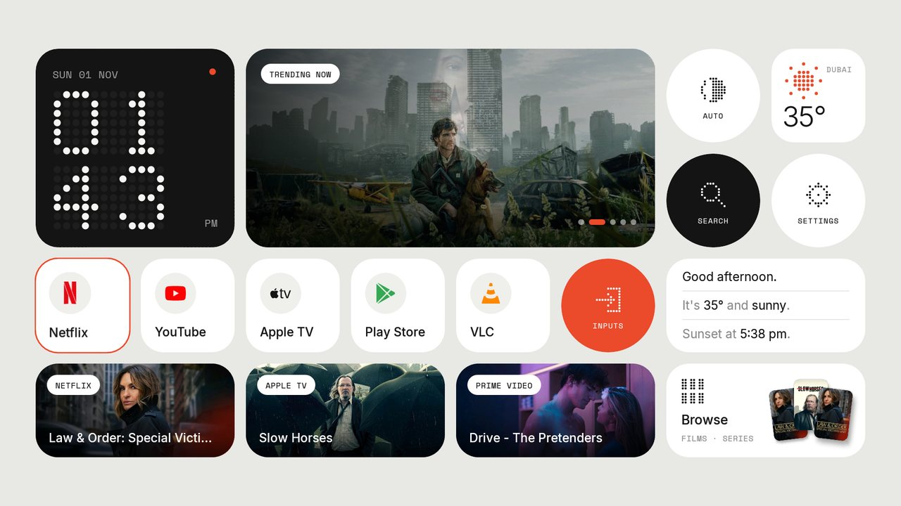
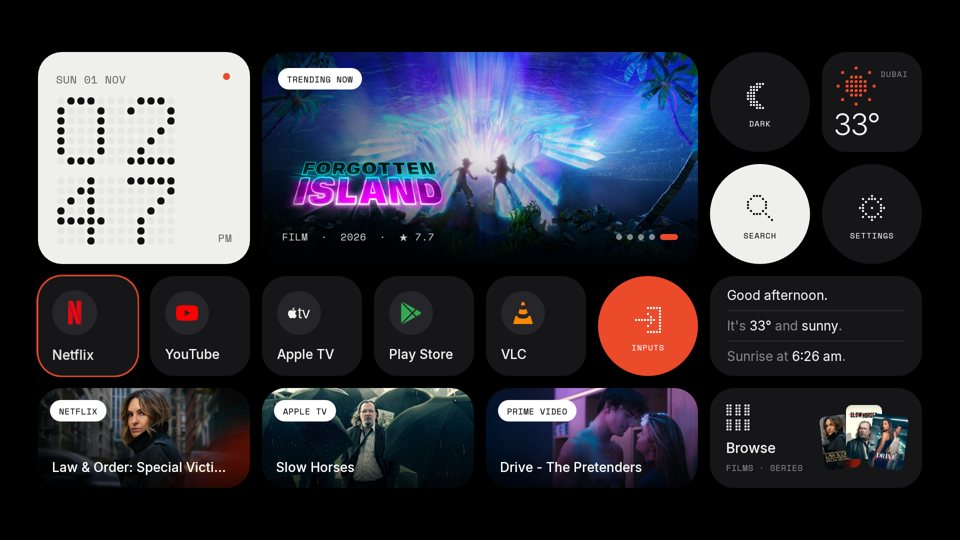
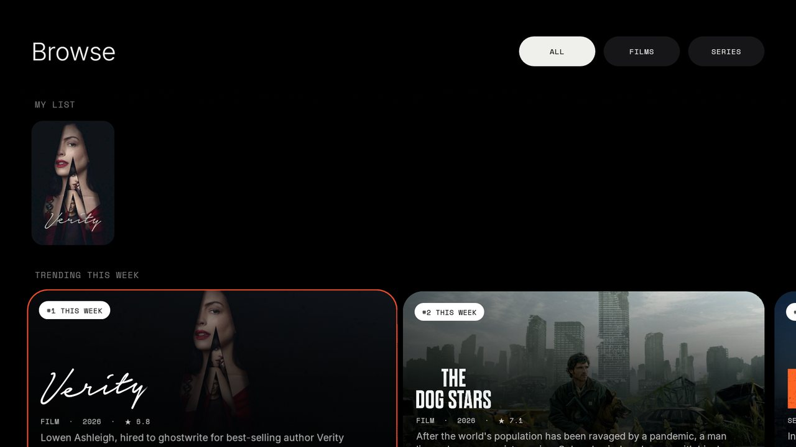
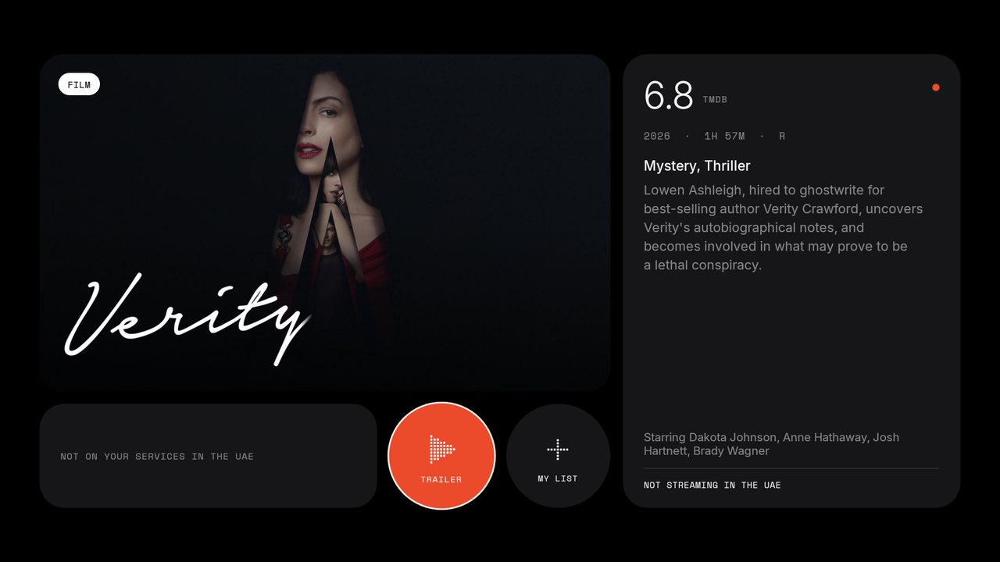
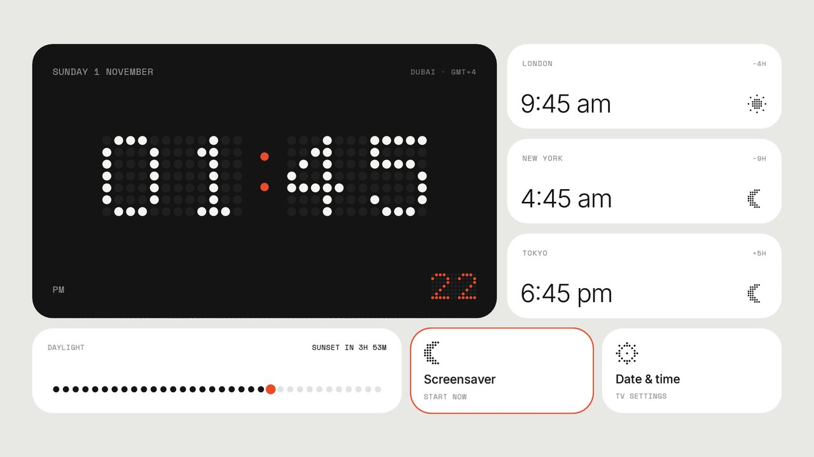
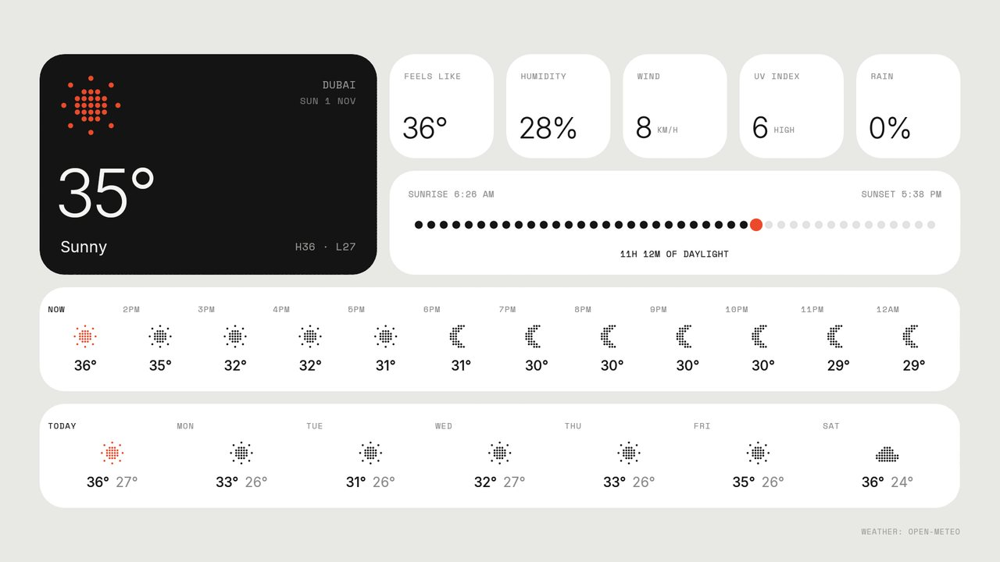
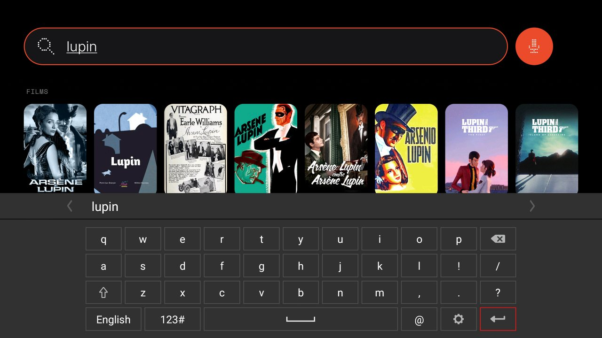
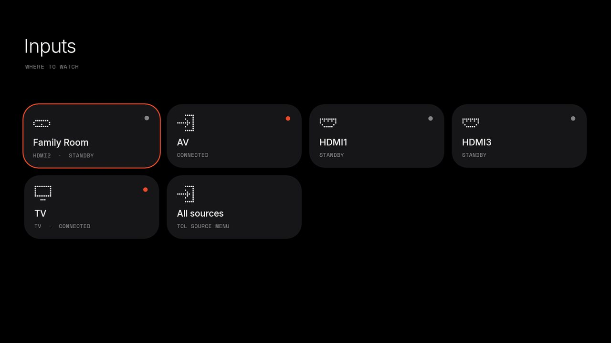
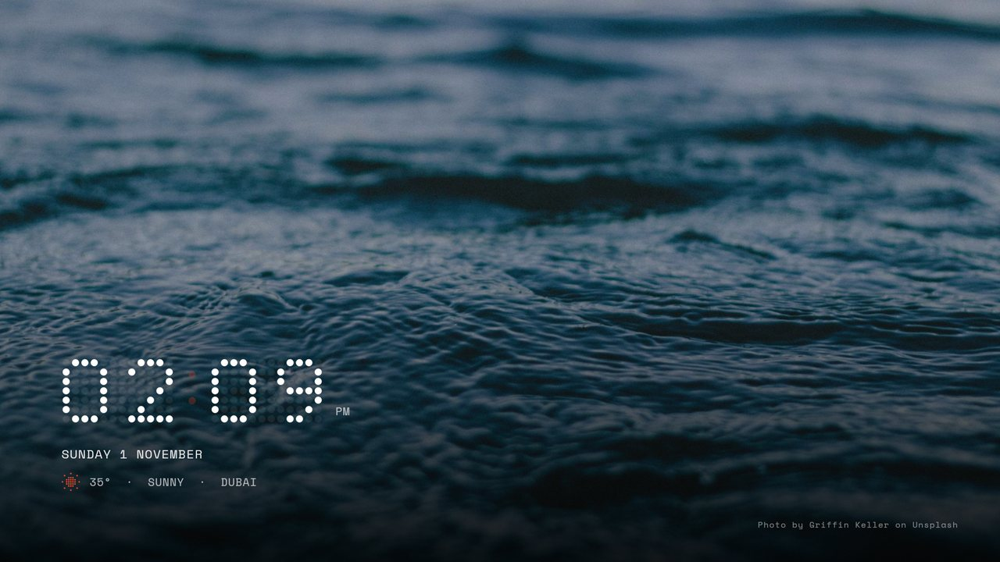

# Something TV

A custom Home screen for Android TV, built for a TCL X9026 (Android TV 8, 2 GB) in Dubai. It's a grid of tiles in
the manner of Nothing's widgets: a dot-matrix clock, dot icons, monospaced labels, light by day and dark by night,
and one accent colour (`#EB4A2B`) in both. Plain Java, no libraries.





## What's in it

- **Home**: the clock, a rotating "Trending now" tile with title logos, Dubai weather, your apps (brand glyphs on
  plain circles), a greeting with the next sunrise or sunset, a pick from each UAE service, and a Browse tile.
  Press Down for the shelves below: My List, trending and new-this-month cards, a poster row per service.
- **Clock**: Dubai time with seconds, London / New York / Tokyo, the day's light, the screensaver, Date & time.
- **Weather**: now, feels like, humidity, wind, UV, rain, the next 12 hours and 7 days (Open-Meteo, no key).
- **Browse**: the shelves with All / Films / Series filters.
- **Search**: apps, films and series as you type with the TV keyboard, or by voice.
- **Inputs**: a tile per source, by the name the TV knows it by (an HDMI-CEC device by its own name), one press
  to switch.
- **Detail card**: photo and logo, facts, "Open in" the UAE service that has it, the trailer, My List.
- **Screensaver**: a 4K landscape every minute, drifting slowly, with the dot clock, date and weather.
- **Feel**: a thin focus ring and a small lift, a soft tick when focus moves and a tap on OK (silent when the
  TV's system sounds are off), tiles that come in one after another.
- **Light and dark**: follows Dubai's sunrise and sunset; the circle at the top right of Home switches Auto,
  Light and Dark.

| | |
|---|---|
|  |  |
|  |  |
|  |  |



## Build and install

You need JDK 17, the Android SDK (`local.properties` with `sdk.dir=...`), and the TV with network ADB on.
`install.sh` uses the ADB tools from [cleanyourtv](https://github.com/Gathin23/cleanyourtv) checked out next to this folder as
`../tv-vibehack` (`tools/tv.py`, `tools/b64push.py`).

```bash
TV_HOST=<tv-ip> ./install.sh
```

The script builds the APK, installs it, checks that it really starts, and only then disables the stock launcher
and makes this one Home. If Home ends up anywhere else, it puts the stock launcher back.

### TMDB key (films and series)

Films and series come from The Movie Database. Get a free key at themoviedb.org → Settings → API and put it in
`tmdb.properties` next to this file:

```
TMDB_KEY=...
```

Either the API Key or the Read Access Token works. The file is in `.gitignore`; never commit it. Without a key,
Home shows your apps and no films. Lists are cached on the TV for 6 hours, so Home opens instantly and works
offline with the last lists.

This product uses the TMDB API but is not endorsed or certified by TMDB. Streaming availability: JustWatch.

## Change things

| What | Where |
|---|---|
| Apps that come first, in order | `Apps.java`: `FAVOURITES` |
| Apps never shown | `Apps.java`: `HIDDEN` (Live TV is on the Inputs page instead) |
| Brand glyphs | `Apps.java`: `GLYPHS`, drawables `res/drawable/glyph_*.xml` (Simple Icons) |
| City for weather, sun and clock | `Weather.java`: `CITY`, `ZONE` and the latitude/longitude in `URL` |
| World clocks | `ClockActivity.java`: `WORLD` |
| Streaming services and region | `Tmdb.java`: `MAJOR` and `REGION` (`AE`) |
| Colours, light and dark | `Palette.java`: `ACCENT`, `DAY`, `NIGHT` |
| Grid and focus | `TileActivity` / `MainActivity`: `CELL`, `GAP`, `X0`, `Y0`; `Tiles.java`: `LIFT`, `RING` |
| Dot icons | `DotMatrixView.java`: 9 x 9 patterns |
| Sounds | `res/raw/focus_tick.wav`, `res/raw/tap.wav` |

## How it stays smooth on a 2 GB TV

- Nothing animates while Home sits still (no endless zooms); the seconds dot steps instead of fading.
- Each grid tile is a GPU layer, so a frame moves about 20 ready-made pictures instead of redrawing them.
- Only tiles with photos are clipped to their rounded corners; dot icons are cached as layers.
- Rows more than a screen away are hidden while you're elsewhere on the page.
- Pictures are decoded at tile size in RGB 565, kept in a 24 MB cache, and released while another app is in front.

On the TCL X9026: 1% late frames at idle, about 26% while moving around (median 17 ms per frame).

## Undo

Re-enable the stock launcher and make it Home again (`com.google.android.tvlauncher`), then
`pm uninstall com.tvrefresh.home`. With the cleanyourtv tools: `TV_HOST=<tv-ip> ../tv-vibehack/backup/restore.sh`.

## Credits

- Fonts: Inter and Space Mono (SIL Open Font License, `licenses/`).
- Brand glyphs: [Simple Icons](https://simpleicons.org) (CC0, `licenses/simple-icons-CC0.md`); the brands are their
  owners' trademarks.
- Films and series: [TMDB](https://www.themoviedb.org). Weather: [Open-Meteo](https://open-meteo.com).
  Photos: [Lorem Picsum](https://picsum.photos) (Unsplash).
